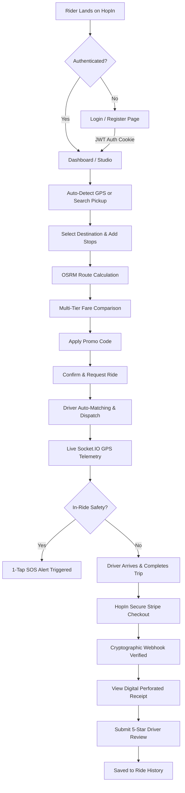

# 🚖 HopIn — Frontend (Rider App)

A modern, glassmorphism-styled Ride-Hailing & Urban Mobility Web Application built with **React 19**, **Vite**, **Tailwind CSS v4**, **Redux Toolkit**, and **Leaflet / OpenStreetMap**. Experience seamless geolocation, multi-tier fare calculation, dynamic multi-stop routing, live driver dispatch tracking, cryptographically verified Stripe checkout, and digital perforated receipts.

---

## 🌐 Live & Local Access

| Environment | Platform | URL |
| :--- | :--- | :--- |
| **Local Development** | Vite Dev Server | `http://localhost:5173` |
| **Production Preview** | Vercel SPA | [https://cab-booking-frontend-drab.vercel.app](https://cab-booking-frontend-drab.vercel.app/) |
| **Backend API Link** | Express 5 Server | `http://localhost:3000` |

---

## 📋 Table of Contents

- [Overview](#-overview)
- [Interactive System Flowchart](#-interactive-system-flowchart)
- [Key Features](#-key-features)
- [Component Architecture](#-component-architecture)
- [Folder Structure](#-folder-structure)
- [Tech Stack](#-tech-stack)
- [Design System & Aesthetics](#-design-system--aesthetics)
- [State Management (Redux Toolkit)](#-state-management-redux-toolkit)
- [Routing & Navigation](#-routing--navigation)
- [Installation & Setup](#-installation--setup)
- [Build & Deployment](#-build--deployment)
- [Available Scripts](#-available-scripts)
- [Dependencies](#-dependencies)
- [Interactive Walkthrough & Testing Guides](#-interactive-walkthrough--testing-guides)

---

## 🔍 Overview

**HopIn** is an urban mobility platform crafted specifically for riders. It eliminates unnecessary complexity by focusing entirely on a friction-free, single-actor booking experience with real-time feedback loops.

### What It Does

1. **Auto-Detects Location:** Uses browser Geolocation GPS with network IP fallback (`ipapi.co`) and OpenStreetMap Photon search.
2. **Instant Multi-Tier Pricing:** Calculates exact distance and estimated travel duration using Open Source Routing Machine (OSRM), rendering real-time fare cards for **Electric Auto**, **Economy Hatchback**, **Comfort Sedan**, and **Premium SUV**.
3. **Multi-Stop Ride Routing:** Add and reorder intermediary pickup/dropoff waypoints on the fly with automatic route and fare recalculations.
4. **Live Dispatch & GPS Tracking:** Watch your assigned driver navigate turn-by-turn towards your pickup point and destination via real-time WebSocket telemetry.
5. **Secure Stripe Checkout:** Pay via saved cards, new cards, UPI, or in-app wallet balance with 256-bit SSL encryption and webhook verification.
6. **Perforated Digital Receipts:** Download, print, or review itemized tax invoices with Stripe transaction reference IDs.
7. **Rider Safety & Support:** Trigger instantaneous SOS alerts with auto-populated emergency contact dispatches and submit live customer support tickets.

---

## 🔄 Interactive System Flowchart



---

## ✨ Key Features

### 🔐 1. Authentication & Security
- **Email & Phone Credentials:** Secure registration and login validated with backend hashing.
- **HTTP-Only Cookies:** JWT tokens stored in secure cookies preventing XSS token theft.
- **401 Response Interceptor:** Global Axios interceptor automatically logs out invalid sessions and redirects to `/login`.
- **Protected Routes:** `ProtectedRoute.jsx` guards dashboard, profile, and history pages.

### 🗺️ 2. Dynamic Map & Waypoints
- **Leaflet & OpenStreetMap:** High-performance vector tile rendering with custom markers for pickup, destination, and live vehicles.
- **Interactive Geocoding:** Real-time location search powered by the Photon API with fallback to Nominatim.
- **Multi-Stop Route Builder:** Support for intermediary stops (`/rides/:id/stops`) with automatic recalculations.

### 🚖 3. Fare Estimation & Tier Selector
- **Dynamic Pricing Engine:** Calculates base fare, per-kilometer rate, estimated duration, and surge multipliers.
- **Four Vehicle Categories:**
  - 🛺 **Auto (Electric Auto):** Quick, eco-friendly budget commutes.
  - 🚗 **Hatchback (Economy):** Everyday pocket-friendly rides.
  - 🚘 **Sedan (Comfort):** Air-conditioned, smooth city travels.
  - 🚙 **SUV (HopIn XL):** Spacious 6-seater premium travel.

### 📡 4. Real-Time Telemetry & Driver Tracking
- **Persistent Socket.IO Rooms:** Riders join dedicated `ride_{id}` rooms for live updates.
- **Smooth Vehicle Interpolation:** Live driver GPS movements, heading angles, and arrival countdowns rendered smoothly on the map.
- **Notification Drawer:** Real-time push badges for status transitions (`DRIVER_ARRIVING`, `IN_PROGRESS`, `COMPLETED`).

### 💳 5. Stripe Checkout & Payment Vault
- **Multi-Method Gateway:** Supports Credit/Debit Cards, UPI IDs (GPay, PhonePe, Paytm), Digital Cash Wallet, and Vaulted Cards.
- **Zero Card Data Stored:** Full PCI-DSS compliance using Stripe tokenized payment intents.
- **Webhook Synchronization:** Real-time cryptographic Stripe signature verification on backend triggers instant UI receipt display.

### 🧾 6. Digital Perforated Receipt & PDF
- **Authentic Invoice Layout:** Custom perforated tear-line styling with receipt timestamp, driver credentials, vehicle license number, and itemized fare breakdown.
- **1-Click PDF Printing:** Native browser print stylesheets hide UI chrome for clean invoice PDF saving.

### 🛡️ 7. Emergency SOS & Safety Hub
- **1-Click Emergency SOS:** Broadcasts live GPS coordinates to trusted emergency contacts and active dispatch monitors.
- **Emergency Contacts Directory:** Add, view, and manage verified emergency contact phone numbers.

### 🎫 8. Customer Support & Ride History
- **In-App Help Desk:** Open categorized support tickets (`PAYMENT`, `LOST_ITEM`, `DRIVER_ISSUE`, `RIDE_ISSUE`) with automated instant resolutions.
- **Filterable Ride History:** View past completed and cancelled trips with fare breakdowns, driver profiles, and downloadable receipts.

---

## 🧩 Component Architecture

```
frontend/src/
├── App.jsx                        # Root router, global ToastContainer & auth guards
├── main.jsx                       # React 19 DOM root & Redux Provider setup
├── index.css                      # Tailwind CSS v4 design tokens & glassmorphism utilities
├── socket.js                      # Persistent Socket.IO singleton client
│
├── https/
│   └── axios.js                   # Axios instance, baseURL, withCredentials, 401 interceptor
│
├── redux/
│   ├── store.js                   # Redux store with logout state-reset reducer
│   └── slices/
│       ├── authSlice.js           # Rider authentication, session state & thunks
│       ├── mapSlice.js            # Pickups, destinations, waypoints & OSRM routes
│       ├── rideSlice.js           # Active ride lifecycle, status, driver tracking & history
│       └── paymentSlice.js        # Checkout modal, Stripe intent, saved cards & receipts
│
├── components/
│   ├── ProtectedRoute.jsx         # Auth guard redirecting unauthenticated riders to /login
│   │
│   ├── layout/
│   │   ├── AppLayout.jsx          # Ambient gradient layout shell with responsive container
│   │   └── Navbar.jsx             # Glassmorphism top bar with profile menu & emergency button
│   │
│   ├── ride/
│   │   ├── MapView.jsx            # Interactive Leaflet map with routing machine & live car marker
│   │   ├── PickupSelector.jsx     # GPS auto-detect button & Photon location autocomplete
│   │   ├── DestinationSelector.jsx# Destination input with recent places & stop builder trigger
│   │   ├── RideTypeSelector.jsx   # Interactive vehicle selection cards (Auto, Hatch, Sedan, SUV)
│   │   ├── FareEstimate.jsx       # Real-time itemized fare breakdown & promo code input
│   │   ├── ConfirmRideButton.jsx  # Primary action CTA triggering driver matching dispatch
│   │   ├── ActiveRideCard.jsx     # Live ride control center, driver info & status progress
│   │   ├── MultiStopModal.jsx     # Modal for adding & ordering intermediary waypoints
│   │   ├── DriverProfileModal.jsx # Detailed driver credentials, car specs & rating modal
│   │   ├── CancelRideModal.jsx    # Cancellation reason picker with dynamic cancellation fee rules
│   │   ├── RatingModal.jsx        # Post-ride 5-star rating & written feedback dialog
│   │   └── EmergencySosModal.jsx  # Red-alert SOS trigger modal with live GPS coordinates
│   │
│   ├── payment/
│   │   ├── PaymentModal.jsx       # Root-level Stripe checkout modal (Cards, UPI, Wallet, Saved)
│   │   └── ReceiptModal.jsx       # Perforated printable digital tax invoice modal
│   │
│   ├── history/
│   │   └── ReceiptView.jsx        # Historical ride receipt drawer
│   │
│   ├── profile/
│   │   └── SavedLocations.jsx     # Home / Work quick-access shortcuts
│   │
│   └── support/
│       └── CustomerSupportModal.jsx # Global help desk ticket dialog
│
└── pages/
    ├── Login.jsx                  # Clean rider authentication page
    ├── Register.jsx               # New rider account onboarding page
    ├── Dashboard.jsx              # Main 2-column Booking Studio & Root Modal Mount
    ├── Profile.jsx                # Rider profile details, safety contacts & password settings
    └── RideHistoryPage.jsx        # Past trips ledger with status badges & receipt download
```

---

## 📂 Folder Structure

```bash
frontend/
├── index.html                     # HTML5 shell with Google Inter font
├── vite.config.js                 # Vite configuration with React + Tailwind v4 plugin
├── vercel.json                    # Single-Page Application rewrites for Vercel
├── package.json                   # Dependencies, build scripts & metadata
└── src/
    ├── main.jsx                   # Application entry point
    ├── App.jsx                    # Core route definitions
    ├── index.css                  # Modern Tailwind CSS v4 styling rules
    ├── socket.js                  # WebSocket client configuration
    ├── https/                     # HTTP client abstraction
    ├── redux/                     # Redux Toolkit store and slices
    ├── components/                # Reusable UI components & dialogs
    └── pages/                     # Routed view containers
```

---

## 🛠️ Tech Stack

| Technology | Version | Category | Purpose |
| :--- | :--- | :--- | :--- |
| **React** | `^19.2.8` | UI Framework | Concurrent UI rendering with modern hooks |
| **Vite** | `^8.3.0` | Build Tool | Lightning-fast HMR dev server and ESBuild bundler |
| **Tailwind CSS** | `^4.3.3` | Styling | Modern utility-first CSS engine via `@tailwindcss/vite` |
| **Redux Toolkit** | `^2.13.0` | State Store | Predictable global state management and async thunks |
| **React Redux** | `^9.3.0` | State Connector | Official React bindings for Redux |
| **React Router DOM** | `^7.18.4` | Routing | Declarative client-side SPA routing and guards |
| **Leaflet** | `^1.9.4` | Mapping | Mobile-friendly interactive map engine |
| **React Leaflet** | `^5.0.0` | Mapping | React wrapper components for Leaflet layers |
| **Leaflet Routing Machine**| `^3.2.12` | Waypoints | Polyline route calculation and road rendering |
| **Axios** | `^1.20.0` | HTTP Client | Promise-based HTTP client with cookie support |
| **Socket.IO Client** | `^4.8.4` (ESM) | WebSockets | Real-time bidirectional telemetry communication |
| **Lucide React** | `^1.59.0` | Icons | Feather-inspired clean SVG icon system |
| **React Toastify** | `^11.1.0` | Notifications | Rich feedback toast alerts |

---

## 🎨 Design System & Aesthetics

HopIn is designed with a **Warm Coral & Peach Glassmorphism** visual identity that feels friendly, premium, and responsive.

### Core Color Palette

| Token Name | Hex Code | Visual Swatch | Application |
| :--- | :--- | :--- | :--- |
| **Coral Primary** | `#FF7A59` |  | Primary action buttons, active icons, brand accents |
| **Coral Dark** | `#E8532E` |  | Button hover states, gradients, price emphasis |
| **Warm Peach Soft** | `#FFF5F1` |  | Light card backgrounds, highlighted tabs |
| **Dark Espresso** | `#3B2A2A` |  | Primary headings, dark CTAs, high-contrast labels |
| **Muted Coffee** | `#7A6A6A` |  | Secondary text, route addresses, timestamps |
| **Emerald Success** | `#059669` |  | Verified Stripe payment badges, live ride status |
| **Crimson Alert** | `#DC2626` |  | SOS emergency button, ride cancellation alerts |

### Glassmorphism Utility Spec

```css
/* Card & Panel Glassmorphism */
background: rgba(255, 255, 255, 0.88);
backdrop-filter: blur(24px);
-webkit-backdrop-filter: blur(24px);
border: 1px solid rgba(255, 255, 255, 0.7);
box-shadow: 0 20px 40px -15px rgba(232, 83, 46, 0.08);

/* Root Modal Placement Rule */
/* Fixed modals are mounted at Dashboard root to prevent containing-block entrapment from CSS transforms */
```

---

## 📦 State Management (Redux Toolkit)

Global state is organized into four distinct slices in `frontend/src/redux/`:

### 1. `authSlice.js`
| State Field | Type | Description |
| :--- | :--- | :--- |
| `user` | `Object \| null` | Authenticated rider profile data |
| `isAuthenticated` | `Boolean` | Computed from user session status |
| `loading` | `Boolean` | Async request pending state |
| `error` | `String \| null` | Authentication error message |

**Thunks:** `registerUser`, `loginUser`, `logoutUser`, `getMe`, `updateUserProfile`, `changePassword`.

---

### 2. `mapSlice.js`
| State Field | Type | Description |
| :--- | :--- | :--- |
| `pickup` | `Object \| null` | Lat, Lng, formatted address, and short title |
| `destination` | `Object \| null` | Lat, Lng, formatted address, and short title |
| `route` | `Object \| null` | OSRM polyline coordinates, distanceKm, and durationMin |
| `searchResults` | `Array` | Photon geocoding query suggestions |

**Thunks / Actions:** `calculateRoute`, `searchPlaces`, `setPickup`, `setDestination`, `clearDestination`.

---

### 3. `rideSlice.js`
| State Field | Type | Description |
| :--- | :--- | :--- |
| `currentRide` | `Object \| null` | Active ride transaction record |
| `fareEstimates` | `Array` | Tiered pricing for Auto, Hatchback, Sedan, SUV |
| `selectedTier` | `String` | Selected vehicle type (`AUTO`, `HATCHBACK`, `SEDAN`, `SUV`) |
| `driverLocation` | `Object \| null` | Live simulated coordinates (`{ latitude, longitude, heading }`) |
| `rideHistory` | `Array` | Historical completed and cancelled rides |
| `currentRideStops` | `Array` | Intermediary ordered waypoints |

**Thunks / Actions:** `fetchFareEstimates`, `createRide`, `cancelRide`, `fetchRideHistory`, `submitReview`, `fetchRideStops`, `addRideStop`.

---

### 4. `paymentSlice.js`
| State Field | Type | Description |
| :--- | :--- | :--- |
| `isPaymentModalOpen` | `Boolean` | Controls Stripe checkout modal visibility |
| `isReceiptModalOpen` | `Boolean` | Controls digital tax invoice modal visibility |
| `currentPayment` | `Object \| null` | Verified transaction details and Stripe reference |
| `paymentMethods` | `Array` | Vaulted credit cards and payment sources |
| `intent` | `Object \| null` | Client secret and ID generated by Stripe |

**Thunks / Actions:** `createPaymentIntent`, `simulateVerifiedPayment`, `fetchPaymentMethods`, `addPaymentMethod`, `openPaymentModal`, `closePaymentModal`, `openReceiptModal`, `closeReceiptModal`.

---

## 🗺️ Routing & Navigation

| Path | View / Component | Auth Required | Description |
| :--- | :--- | :---: | :--- |
| `/login` | `Login.jsx` | ❌ | Rider sign-in portal; redirects to `/` if logged in |
| `/register` | `Register.jsx` | ❌ | Rider registration portal; redirects to `/` if logged in |
| `/` | `Dashboard.jsx` | ✅ | Central Booking Studio, interactive map, active ride tracking |
| `/history` | `RideHistoryPage.jsx` | ✅ | Past trips ledger, status badges, and invoice retrieval |
| `/profile` | `Profile.jsx` | ✅ | Personal credentials, saved home/work shortcuts, safety contacts |
| `*` | Navigate redirect | — | Unknown routes cleanly redirect back to `/` |

---

## 🚀 Installation & Setup

### Prerequisites
- **Node.js:** `v18.x` or higher (`v20+` or `v22+` recommended)
- **npm:** `v9.x` or higher
- **Running Backend Server:** HopIn Express Backend running on port 3000

### Step-by-Step Instructions

```bash
# 1. Clone the repository and enter the frontend folder
cd frontend

# 2. Install all dependencies
npm install

# 3. Start the local development server with Hot Module Replacement (HMR)
npm run dev
```

The application will be available at: **`http://localhost:5173`**

---

## 🏗️ Build & Deployment

### Compiling Production Bundle

```bash
# Generate optimized production assets in /dist
npm run build
```

### Deploying to Vercel
1. Link your repository in the [Vercel Dashboard](https://vercel.com).
2. Configure **Root Directory** as `frontend`.
3. Deploy! The included `vercel.json` automatically manages Single-Page Application client routing:

```json
{
  "rewrites": [
    { "source": "/(.*)", "destination": "/index.html" }
  ]
}
```

---

## 📜 Available Scripts

| Command | Action |
| :--- | :--- |
| `npm run dev` | Runs the Vite dev server with instant HMR on `localhost:5173` |
| `npm run build` | Bundles and minifies code into the `dist/` directory for deployment |
| `npm run preview` | Locally serves the production build to verify output |
| `npm run lint` | Analyzes code quality using ESLint |

---

## 📦 Dependencies

### Core Production Dependencies
```json
{
  "@reduxjs/toolkit": "^2.13.0",
  "axios": "^1.20.0",
  "leaflet": "^1.9.4",
  "leaflet-routing-machine": "^3.2.12",
  "lucide-react": "^1.59.0",
  "react": "^19.2.8",
  "react-dom": "^19.2.8",
  "react-icons": "^5.7.0",
  "react-leaflet": "^5.0.0",
  "react-redux": "^9.3.0",
  "react-router-dom": "^7.18.4",
  "react-toastify": "^11.1.0"
}
```

### Development Dependencies
```json
{
  "@tailwindcss/vite": "^4.3.3",
  "@vitejs/plugin-react": "^6.1.1",
  "eslint": "^10.10.0",
  "tailwindcss": "^4.3.3",
  "vite": "^8.3.0"
}
```

---

## 💡 Interactive Walkthrough & Testing Guides

<details>
<summary><b>🧪 Click to expand: End-to-End Rider Testing Checklist</b></summary>

Follow these steps to experience the complete booking journey:

- [ ] **1. Sign Up / Sign In:** Register a new rider account or log into an existing account.
- [ ] **2. Location Lookup:** Click the GPS target icon in the Pickup field to detect your location or type in a pickup landmark.
- [ ] **3. Set Destination:** Type a destination (e.g. airport, city center) and review the computed polyline on the map.
- [ ] **4. Add Waypoints (Optional):** Click "+ Add Stop" to create an intermediary waypoint.
- [ ] **5. Select Vehicle:** Choose between Electric Auto, Hatchback, Sedan, or SUV and review the estimated fare and travel time.
- [ ] **6. Apply Promo Code (Optional):** Enter a valid promo code (e.g. `HOPIN50`) to receive an instant fare discount.
- [ ] **7. Confirm Ride:** Click "Request HopIn" to start driver matching.
- [ ] **8. Track Dispatch:** Watch the driver accept the ride, navigate towards your pickup point, and start the journey.
- [ ] **9. Test Safety Hub:** Click the emergency SOS icon to view the active SOS alert and test contact dispatching.
- [ ] **10. Complete & Pay:** Once the driver completes the ride, select Stripe Card or UPI in the checkout modal and complete payment.
- [ ] **11. View Receipt:** Review your perforated tax invoice with the verified Stripe transaction reference and print as PDF.
- [ ] **12. Rate Driver:** Submit a 5-star rating and written review for the driver.
- [ ] **13. Check History:** Navigate to `/history` to confirm the ride was archived with receipt access.

</details>

<details>
<summary><b>❓ Click to expand: Frequently Asked Questions & Troubleshooting</b></summary>

**Q: Why does the map show a default city if GPS permissions are denied?**  
A: If browser GPS permission is denied or times out, HopIn uses IP-based geocoding (`ipapi.co`) to automatically position the map in your current metropolitan area.

**Q: How does the payment webhook verification work?**  
A: When you click "Pay with Stripe", the client dispatches a secure intent request. The backend signs and verifies the transaction using cryptographic webhooks, automatically signaling the client via WebSocket to reveal the digital receipt.

**Q: Where can I review my previous ride receipts?**  
A: Click on your profile menu in the top navigation bar and select **"Ride History"** or visit `/history`. Every completed ride contains a "View Receipt" button.

</details>

---

## 👥 Authors & License

- **HopIn Team** — Developed with passion for modern urban mobility.
- **License:** ISC
